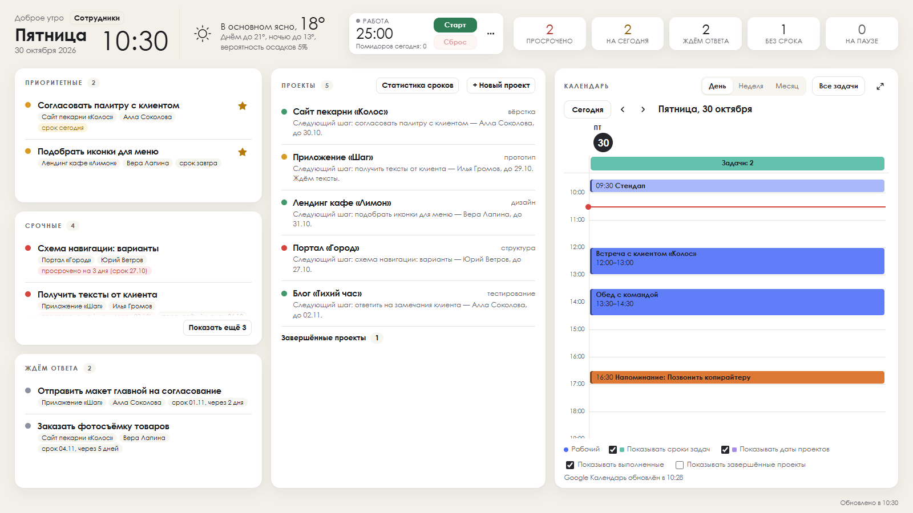

# Мой день

Настольная программа для Windows, которая показывает ваш день на одном экране: задачи по проектам, сроки, календарь,
таймер «Помидоро» и погоду. Работает на вашем компьютере, без регистрации и облака; может стоять вместо обоев рабочего стола.



**Подробная инструкция для пользователя — [docs/ИНСТРУКЦИЯ.md](docs/ИНСТРУКЦИЯ.md).**

Автор — Улугбек Махмудов (Ulugbek Makhmudov), © 2026. Лицензия — [MIT](LICENSE).

## Возможности

- Проекты и задачи: исполнители, сроки со временем, звезда «приоритетная», «ждём ответа», пауза, комментарии.
- Срок переносится на более позднюю дату только с причиной; история переносов и статистика сроков по сотрудникам и проектам.
- Календарь «День / Неделя / Месяц», на весь экран; события Google Календаря, iCloud или Outlook по секретному адресу iCal; напоминания.
- Таймер «Помидоро» с уведомлением Windows «Время вышло» и звуком (выключается).
- Режим обоев рабочего стола, значок у часов, автозапуск.
- Локальный JSON API на `127.0.0.1:8648` — по желанию можно подключить своего ИИ-агента (Claude Code, Codex, Gemini CLI и др.).

## Быстрый старт

1. Скачайте `MoyDenSetup-<версия>.exe` в разделе **Releases** этого репозитория.
2. Запустите его. Если Windows покажет «Windows защитил ваш компьютер» (SmartScreen предупреждает о программах без платной
   подписи), нажмите «Подробнее» → «Выполнить в любом случае».
3. Откройте «Мой день» из меню «Пуск». Программа стартует пустой: создайте проект («+ Новый проект») и добавьте задачи.
4. Крестик прячет окно в значок у часов; полностью закрыть — значок у часов → «Выйти».

Ваши данные — в папке `%LOCALAPPDATA%\MoyDen` (резервная копия — скопировать эту папку). Удаление программы данные не трогает.
Контрольная сумма sha256 установщика указана в описании релиза: `certutil -hashfile MoyDenSetup-1.0.0.exe SHA256`.

## Требования

- Windows 10 или 11 (64-бит).
- Microsoft Edge WebView2 Runtime — в Windows 11 уже есть; для Windows 10 при необходимости ставится с сайта Microsoft.
- Права администратора не нужны.

## Сборка из исходников

Нужен Python 3.13 для Windows.

```bat
python -m venv .venv
.venv\Scripts\python.exe -m pip install -r requirements.txt
.venv\Scripts\pythonw.exe app.py                 :: запуск из исходников (данные — рядом, в папке репозитория)
.venv\Scripts\python.exe build_installer.py      :: сборка: _сборка\MoyDenSetup-<версия>.exe
```

`build_app.py` собирает только программу (`_сборка\dist\MoyDen.exe`), `build_installer.py` — программу и установщик.

Установщик понимает ключи (для проверок): `--target ПАПКА`, `--data ПАПКА`, `--port N`, `--instance ИМЯ` (отдельный экземпляр со своим
окном и портом), `--start-dir`, `--startup-dir`, `--desktop-dir`, `--launch`, `--quiet`, `--uninstall`. Рядом с другой сборкой «Мой день»
(ключ `MoyDen` в «Установленных приложениях») установщик не ставится; ключ `--regkey MoyDen` запрещён. Проверочная установка рядом
с ней — только `--side-by-side-test` вместе с `--instance`, `--port` и всеми папками (`--data`, `--start-dir`, `--startup-dir`,
`--desktop-dir`) обычными путями с буквой диска внутри той же временной папки, где лежит `--target`; эта папка не должна пересекаться
с папками Windows («Главное меню», «Автозагрузка», «Рабочий стол»), папкой и данными другой сборки. Удалитель не трогает другую сборку.

## Проверки

```bat
set MOYDEN_NO_TOAST=1
.venv\Scripts\python.exe -m unittest discover -s tests -p "test_*.py" -t .
```

Сквозные проверки страницы (`tests\e2e*.js`) идут в безголовом Chrome через `puppeteer-core`:

```bat
npm install puppeteer-core
set PY=%CD%\.venv\Scripts\python.exe
set MOYDEN_NO_TOAST=1
cd tests && node e2e.js
```

Путь к Chrome по умолчанию — `C:\Program Files\Google\Chrome\Application\chrome.exe` (другой — переменной `CHROME_PATH`),
к puppeteer — переменной `PUPPETEER_PATH`. Проверки работают на временных копиях данных и не трогают ваши.

## Конфиденциальность

Программа ничего не отправляет автору: нет телеметрии, отчётов об ошибках и проверки обновлений. Внешние обращения — только
те, что настраивает сам пользователь: адреса его календарей (iCal по https: Google, iCloud, Outlook) и сервис погоды
Open-Meteo (`api.open-meteo.com`), если в настройках задан город. По умолчанию город не задан и погода не запрашивается.

## Поддержка

Программа предоставляется бесплатно, **«как есть»**, по лицензии MIT — без гарантий и без технической поддержки. Разбираться —
по [инструкции](docs/ИНСТРУКЦИЯ.md). Хотите изменить под себя — сделайте форк и дорабатывайте.

---

## English

**Moy Den** ("My Day") is a free Windows 10/11 desktop dashboard: tasks by project with deadlines (moving a deadline later
requires a reason; history and statistics are kept), a day/week/month calendar fed by your own iCal links, a Pomodoro timer
with Windows notifications, optional weather, a desktop-wallpaper mode and a local JSON API (`127.0.0.1:8648`) that your own
AI agent may use. Data stays on your computer in `%LOCALAPPDATA%\MoyDen`; no telemetry. Download the installer from Releases
(SmartScreen: "More info" → "Run anyway"); WebView2 is required. The UI and the [user guide](docs/ИНСТРУКЦИЯ.md) are in Russian
(the guide ends with an English summary). Provided free "as is" under the MIT license, without warranty or support.
Author: Ulugbek Makhmudov, © 2026.
