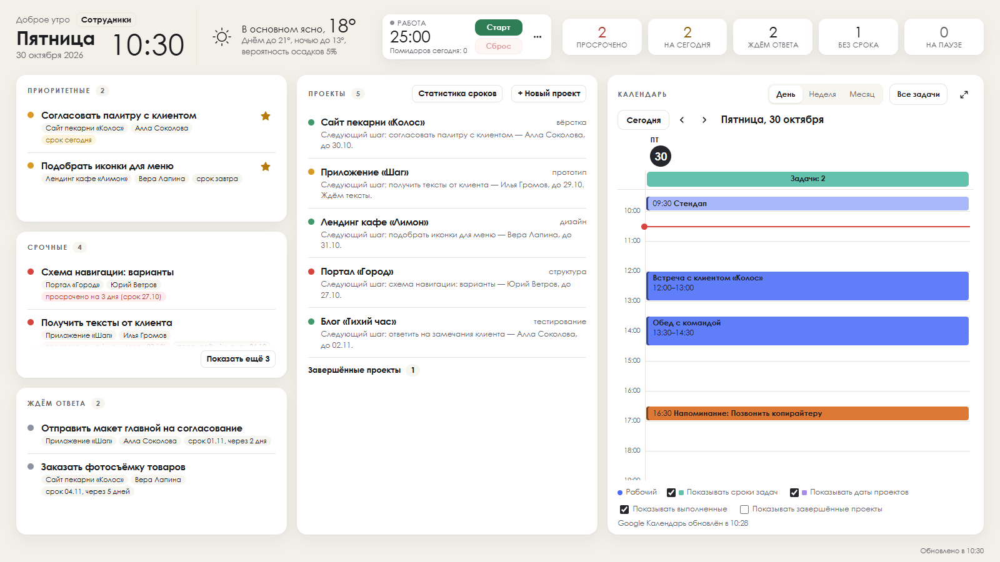
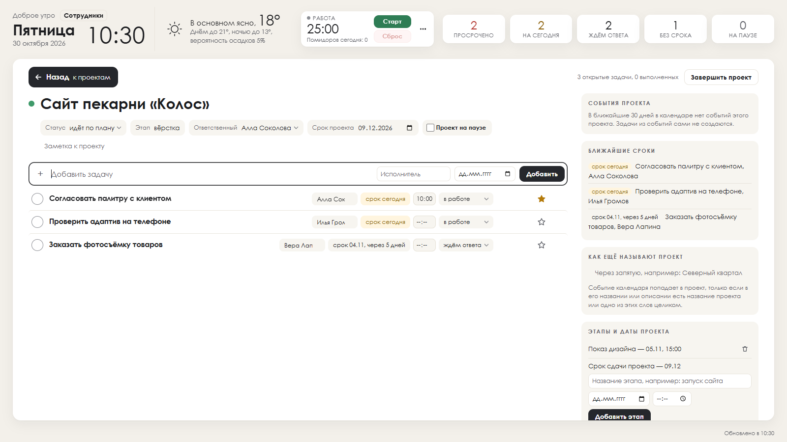
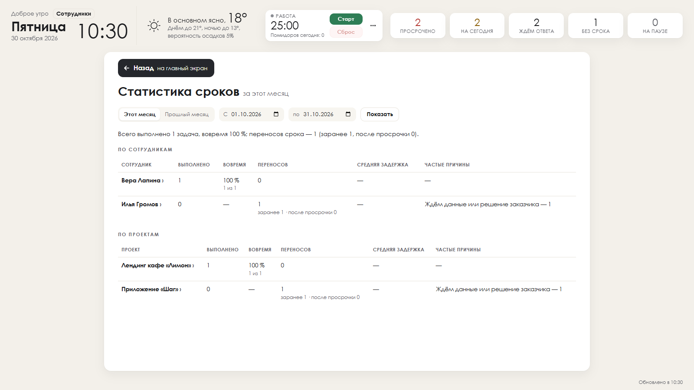
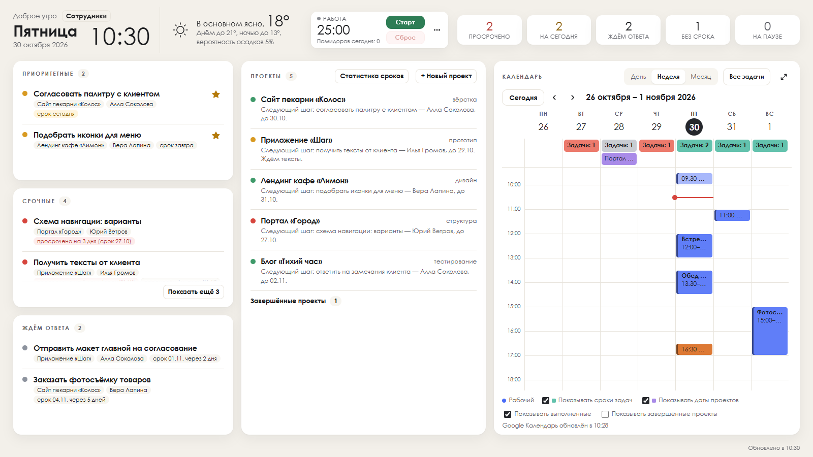
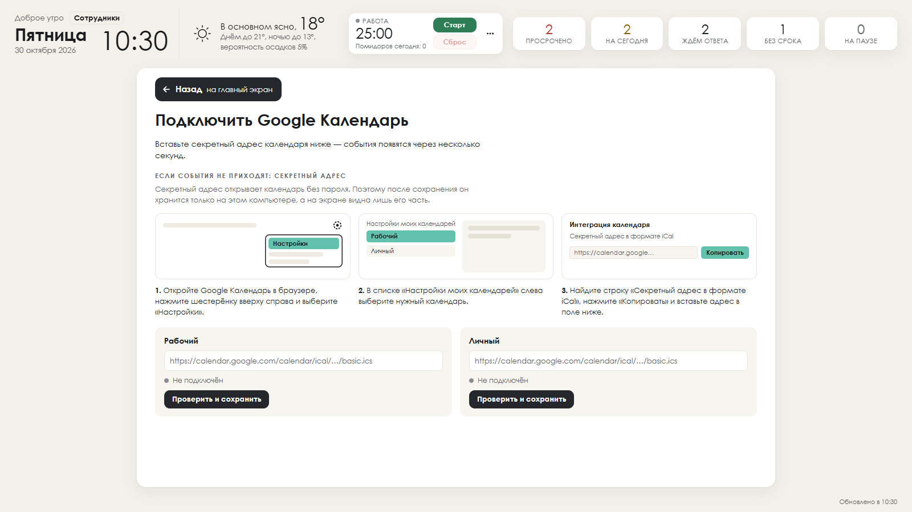

# «Мой день» — инструкция

«Мой день» — небольшая программа для Windows, которая собирает на одном экране всё, чем вы заняты сегодня: задачи по проектам,
сроки, календарь, таймер «Помидоро» и погоду. Она работает на вашем компьютере, без регистрации и без облака: ваши задачи
никуда не отправляются и хранятся в одной папке, которую легко скопировать.

Автор — Улугбек Махмудов (Ulugbek Makhmudov), © 2026. Программа распространяется бесплатно по лицензии MIT.



## Содержание

1. [Что нужно для работы](#что-нужно-для-работы)
2. [Установка](#установка)
3. [Первый запуск](#первый-запуск)
4. [Окно, значок у часов и режим обоев](#окно-значок-у-часов-и-режим-обоев)
5. [Проекты](#проекты)
6. [Задачи](#задачи)
7. [Сроки: перенос с причиной, история и статистика](#сроки-перенос-с-причиной-история-и-статистика)
8. [Календарь](#календарь)
9. [Как подключить свой календарь Google](#как-подключить-свой-календарь-google)
10. [Таймер «Помидоро»](#таймер-помидоро)
11. [Погода](#погода)
12. [Сотрудники](#сотрудники)
13. [Настройки](#настройки)
14. [Где хранятся данные, резервная копия и перенос на другой компьютер](#где-хранятся-данные-резервная-копия-и-перенос-на-другой-компьютер)
15. [Обновление и удаление](#обновление-и-удаление)
16. [Работа вместе с ИИ-агентом (по желанию)](#работа-вместе-с-ии-агентом-по-желанию)
17. [Частые вопросы и что делать, если что-то не работает](#частые-вопросы-и-что-делать-если-что-то-не-работает)
18. [Поддержка](#поддержка)
19. [English summary](#english-summary)

---

## Что нужно для работы

- **Windows 10 или Windows 11.**
- **Microsoft Edge WebView2** — встроенный в Windows «движок» для показа страниц. В Windows 11 и в обновлённой Windows 10 он уже есть.
  Если окно программы не открывается, установите его с сайта Microsoft: страница «Microsoft Edge WebView2», вариант
  **Evergreen Bootstrapper** (небольшой файл, сам скачивает остальное).
- Права администратора **не нужны**: программа ставится только для вашей учётной записи.
- Интернет нужен лишь для двух вещей, которые вы включаете сами: календаря по ссылке и погоды. Без интернета программа работает полностью.

## Установка

1. Откройте страницу проекта на GitHub, справа найдите раздел **Releases** и откройте последнюю версию.
2. Скачайте файл **`MoyDenSetup-<версия>.exe`** (например, `MoyDenSetup-1.0.0.exe`).
3. Запустите скачанный файл двойным щелчком.

**Если Windows показывает синее окно «Windows защитил ваш компьютер».** Это фильтр SmartScreen: он предупреждает о каждой
программе, у которой нет платной цифровой подписи и которую скачали ещё немногие. Если файл скачан со страницы Releases этого
проекта, нажмите **«Подробнее»**, затем **«Выполнить в любом случае»**. Если вы сомневаетесь в файле — не запускайте его.
Подлинность файла можно сверить: в описании релиза указана его контрольная сумма sha256, а свою можно узнать командой
`certutil -hashfile MoyDenSetup-1.0.0.exe SHA256` в командной строке.

Установщик работает без мастера с кнопками «Далее»: через несколько секунд он покажет сообщение «„Мой день“ 1.0.0 установлен»
— в нём сказано, где лежит программа и где будут ваши данные.

Что делает установка:

- кладёт программу в папку `%LOCALAPPDATA%\Programs\MoyDen`;
- создаёт папку для данных `%LOCALAPPDATA%\MoyDen`;
- добавляет «Мой день» в меню «Пуск» и в автозагрузку (программа будет открываться сама при входе в Windows);
- регистрирует программу в «Параметры → Приложения → Установленные приложения», чтобы её можно было удалить обычным способом.

Ярлык на рабочем столе установщик не создаёт. Если он нужен, откройте меню «Пуск», найдите «Мой день» в списке всех приложений
и перетащите его мышью на рабочий стол — Windows создаст ярлык. Закрепить программу на панели задач можно там же: правая кнопка
мыши → «Закрепить на панели задач».

> Если на компьютере уже стоит другая сборка «Мой день», установщик откажется ставить вторую рядом и попросит
> сначала удалить ту: у двух сборок одинаковые ярлыки и названия окон, и они мешали бы друг другу.

## Первый запуск

Откройте «Мой день» из меню «Пуск». При первом запуске программа **пустая**: ни задач, ни проектов, ни сотрудников. Она сама
создаёт файл данных в папке `%LOCALAPPDATA%\MoyDen`.

С чего начать:

1. На главном экране в блоке **«Проекты»** нажмите **«+ Новый проект»**, впишите название и нажмите Enter — откроется экран проекта.
2. В строке **«Добавить задачу»** впишите задачу, при желании исполнителя и срок, нажмите **«Добавить»** или Enter.
3. Вернитесь на главный экран кнопкой **«Назад»** (или клавишей Esc) — задача уже в нужных блоках и в календаре.

Через несколько секунд после запуска у значка в панели задач появится подсказка, как закрепить программу на панели задач.

## Окно, значок у часов и режим обоев

**Главный экран** делится на три колонки:

- слева — блоки **«Приоритетные»** (задачи со звёздой), **«Срочные»** (просроченные и на сегодня) и **«Ждём ответа»**;
- посередине — **«Проекты»**;
- справа — **«Календарь»**.

Вверху — приветствие, день недели, дата и часы, погода (если включена), таймер «Помидоро» и пять счётчиков: **просрочено**,
**на сегодня**, **ждём ответа**, **без срока**, **на паузе**. Нажатие на счётчик открывает список этих задач. В правом нижнем углу
написано, когда данные обновлялись последний раз. Изменения, сделанные в другом окне или через API, появляются на экране сами
в течение нескольких секунд.

Если список не помещается в блок, внизу появляется кнопка **«Показать ещё N»** — она прокручивает список к следующим пунктам;
когда список прокручен до конца, на её месте появляется **«В начало»**. Блоки прокручиваются и колёсиком мыши.

**Значок у часов** (в области уведомлений, справа на панели задач). Меню по правой кнопке мыши:

- **«Открыть „Мой день“»** — показать окно (то же делает щелчок по значку);
- **«Показывать как обои рабочего стола»** — включить или выключить режим обоев (галочка показывает, что он включён);
- **«О программе»** — версия, папка данных и папка программы;
- **«Выйти»** — закрыть программу полностью.

Крестик в углу окна **не закрывает** программу, а прячет окно в значок у часов: таймер, уведомления и обои продолжают работать.
Повторный запуск из «Пуска» не открывает вторую копию, а выводит уже открытое окно вперёд.

**Режим обоев.** В этом режиме «Мой день» занимает рабочий стол вместо картинки: окна других программ лежат поверх, а когда вы
сворачиваете их, перед вами ваш день. На обоях работают все кнопки — можно отмечать задачи, переключать календарь, запускать
таймер. Слева остаётся полоса под значки рабочего стола.

- Включить: значок у часов → «Показывать как обои рабочего стола».
- Выключить: то же самое ещё раз (галочка снимется).
- Чтобы обои включались сами при каждом запуске программы, в файле настроек поставьте `"window": true` в разделе `"wallpaper"`
  (см. раздел «Настройки»).

## Проекты

Проект — это папка для задач с общим названием, статусом и сроком.

- **Создать:** главный экран → «+ Новый проект».
- **Открыть:** щёлкните по названию проекта. Вверху экрана проекта — **статус** («идёт по плану», «есть риск», «срыв»),
  **этап**, **ответственный**, **срок проекта**, флажок **«Проект на паузе»** и заметка.
- **Этапы и даты** (справа) — промежуточные даты, например «Сдача эскиза — 15.11, 15:00». Они и срок проекта видны в календаре
  фиолетовым.
- **«Как ещё называют проект»** — синонимы через запятую. Событие календаря само попадает в проект, если в его названии или
  описании есть название проекта или один из синонимов **целым словом**.
- **Пауза.** Флажок «Проект на паузе» с причиной и датой «вернуть к работе до». Проект на паузе не пропадает, а переходит в
  счётчик «на паузе».
- **Завершить проект** — кнопка вверху справа на экране проекта. Если в проекте остались открытые задачи, программа спросит,
  что с ними сделать: отметить выполненными, оставить как есть или перенести в другой проект. Можно написать итог.
- **Завершённые проекты** — строка внизу блока «Проекты». Там же кнопка **«Вернуть в работу»**: проект вернётся, а задачи,
  закрытые при завершении, снова откроются.



## Задачи

**Добавить.** Откройте проект и заполните строку «Добавить задачу»: текст, исполнитель (начните печатать имя — появятся
подсказки из списка сотрудников) и срок. Enter или кнопка «Добавить».

**Изменить.** Всё правится прямо в строке задачи: щёлкните по названию, исполнителю, сроку, времени или состоянию.
Состояний три: **в работе**, **ждём ответа** и **выполнено**. Esc отменяет правку, которую вы ещё не сохранили.

**Приоритет — звезда.** Звёздочка справа в строке задачи (подсказка «Приоритетная») переносит задачу в блок «Приоритетные»
на главном экране. Повторное нажатие снимает звезду.

**Выполнить.** Кружок слева от названия. Выполненная задача зачёркивается и уходит в раскрывающийся список «Выполненные» внизу
проекта; оттуда её можно вернуть в работу тем же кружком.

**Пауза и комментарии.** В строке задачи есть кнопки паузы и комментариев. Комментарии — это короткая лента заметок к задаче:
последняя видна прямо в строке.

**Удалить.** После удаления внизу экрана несколько секунд видна кнопка «Вернуть».

## Сроки: перенос с причиной, история и статистика

Первый срок, который вы поставили задаче, программа запоминает как **плановый**.

**Перенос срока на более позднюю дату** (и снятие срока) — только с причиной. Когда вы меняете дату на более позднюю, появляется
окно **«Почему переносим?»** с вариантами:

- сотрудник не успел;
- ждём данные или решение заказчика;
- заказчик изменил задание;
- ждём смежников;
- сменился приоритет;
- другое — тогда коротко напишите причину своими словами.

Перенос на более раннюю дату причины не требует.

**История переносов.** У перенесённой задачи появляется отметка с плановым сроком; нажатие на неё открывает **историю
переносов**: с какой даты на какую, когда и почему.

**Статистика сроков** — кнопка в блоке «Проекты» на главном экране. Выберите «Этот месяц», «Прошлый месяц» или свой период
(до 400 дней) и нажмите «Показать». Таблицы по сотрудникам и по проектам показывают: сколько задач выполнено, какая доля —
вовремя, сколько было переносов (заранее и после просрочки), среднюю задержку и самые частые причины.



## Календарь

Календарь в правой колонке показывает сроки задач, этапы проектов, ваши напоминания и события подключённых календарей.

- **День, Неделя, Месяц** — переключатель вверху блока. Стрелки листают дни (недели, месяцы), кнопка **«Сегодня»** возвращает
  к текущему дню. Красная линия — текущее время.
- **⤢ (Развернуть)** — календарь на весь экран. Обратно — кнопка «Назад» или Esc.
- **Все задачи** — список всех задач по датам.
- Щелчок по **событию** показывает время, место и описание; если событие относится к проекту, отсюда можно перейти в проект
  или сделать из события задачу.
- Щелчок по **сроку задачи** открывает её в проекте.
- Щелчок по **пустому месту** сетки («День» или «Неделя») создаёт **напоминание** на это время — оно рисуется оранжевым.
- Под календарём — флажки: показывать ли сроки задач, даты проектов, выполненные задачи и завершённые проекты.
- Срок задачи без времени рисуется в 18:00 (час можно поменять в настройках, `taskHour`).



## Как подключить свой календарь Google

Программа читает календарь по **секретному адресу в формате iCal** — только чтение, без входа в аккаунт Google. Подходят адреса
Google Календаря, iCloud и Outlook (только https).

1. Откройте Google Календарь **в браузере на компьютере** (в приложении на телефоне этой настройки нет).
2. Нажмите шестерёнку вверху справа → **«Настройки»**.
3. Слева в разделе **«Настройки моих календарей»** выберите нужный календарь.
4. Прокрутите до блока **«Интеграция календаря»** и найдите строку **«Секретный адрес в формате iCal»**. Нажмите «Копировать».
5. В «Мой день» под календарём нажмите **«Подключение»** — откроется экран «Подключить Google Календарь». В нём два места:
   **«Рабочий»** и **«Личный»**. Вставьте адрес в нужное поле и сохраните.

Программа сразу проверит адрес: если это не календарь или он недоступен, она скажет об этом. Через несколько секунд события
появятся в календаре; дальше они обновляются сами каждые пять минут. Если интернет пропал, остаются последние загруженные
события с пометкой, когда они обновлялись.

> **Важно: никому не показывайте и не публикуйте секретный адрес.** По нему любой человек видит ваш календарь без пароля.
> Программа хранит адрес только на этом компьютере (файл `calendars.local.json` в папке данных) и показывает на экране лишь его
> часть. Если адрес попал к посторонним, в том же блоке Google нажмите «Сбросить» — старая ссылка перестанет работать, а новую
> вставьте в программу заново.

Чтобы отключить календарь, очистите поле и сохраните.



## Таймер «Помидоро»

Таймер в шапке помогает работать отрезками: **25 минут работы → 5 минут перерыва**, после **4** помидоров — длинный перерыв
**15 минут**. Это значения по умолчанию.

- **Старт** запускает отрезок, во время работы та же кнопка ставит **паузу**; **Сброс** возвращает таймер к началу.
- Кнопка **«…»** рядом открывает настройки: к какой задаче относится отрезок, длительности работы, перерыва и длинного перерыва,
  сколько помидоров до длинного перерыва и флажок **«Звук, когда время вышло»**. Нажмите «Сохранить».
- Когда отрезок закончился, таймер встаёт в состояние **«Время вышло»** и ждёт вас: следующий отрезок сам не начинается.
  Нажмите «Старт», чтобы начать следующий, или **«Ещё 5 минут»**, чтобы продлить закончившийся.
- В этот момент Windows показывает **уведомление «Время вышло»**, которое не исчезает само — его закрывают кнопкой «Закрыть».
  Если включён звук, программа три раза подаёт системный звуковой сигнал.
- **Выключить звук:** «…» → снимите флажок «Звук, когда время вышло» → «Сохранить».
- **Выключить уведомления:** Параметры Windows → Система → Уведомления → «Мой день».
- Под таймером — сколько помидоров сделано сегодня.

Таймер идёт, даже если окно спрятано в значок у часов.

## Погода

По умолчанию погода **выключена**: город не задан, и программа никуда за ней не обращается. Чтобы включить, впишите свой город
в файл настроек (`settings.json` в папке данных):

```json
{
  "weather": {
    "enabled": true,
    "cities": [
      {"name": "Мой город", "lat": 55.75, "lon": 37.62, "tz": "auto"}
    ]
  }
}
```

`lat` и `lon` — широта и долгота города (их легко найти в любой карте: щелчок правой кнопкой по месту). Первый город показывается
крупно, следующие — строкой ниже; `"enabled": false` у города прячет его. Данные приходят с открытого сервиса Open-Meteo
(api.open-meteo.com) без ключей и регистрации и обновляются раз в полчаса. Программа подхватывает изменённый файл сама через
несколько секунд.

## Сотрудники

Ссылка **«Сотрудники»** рядом с приветствием. Здесь — список людей, которым вы ставите задачи: имя, фамилия, отчество,
должность, офис, телефон, Telegram, почта и заметки. Карточка сотрудника показывает его открытые задачи.

Сотрудника нельзя удалить бесследно — его отправляют **в архив**; при этом программа спросит, кому передать его открытые задачи.
Выполненные задачи сохраняют прежнее имя.

## Настройки

Все настройки — в файле **`settings.json`** в папке данных. Откройте его Блокнотом, поправьте и сохраните: программа подхватит
изменения сама. Если файла ещё нет, создайте его. Пример со всеми настройками:

```json
{
  "theme": "light",
  "calendar": {"taskHour": "18:00"},
  "weather": {"enabled": false, "cities": []},
  "wallpaper": {"window": false, "iconsStrip": 120}
}
```

- `theme` — `"light"` (светлая) или `"dark"` (тёмная тема).
- `calendar.taskHour` — в какой час рисовать на сетке календаря срок задачи без времени.
- `weather` — погода (см. выше).
- `wallpaper.window` — `true`: включать режим обоев при запуске программы; `wallpaper.iconsStrip` — ширина полосы слева под
  значки рабочего стола, в точках экрана.

Если в файле ошибка (лишняя запятая, незакрытая скобка), программа не упадёт, а будет работать с настройками по умолчанию.

**Автозапуск.** Установщик добавляет программу в автозагрузку. Выключить: «Диспетчер задач» → «Автозагрузка приложений» →
«Мой день» → «Отключить».

## Где хранятся данные, резервная копия и перенос на другой компьютер

Все ваши данные лежат в одной папке: **`%LOCALAPPDATA%\MoyDen`**. Чтобы открыть её, нажмите Win+R, вставьте
`%LOCALAPPDATA%\MoyDen` и нажмите Enter. Точный путь показывает и пункт «О программе» в меню значка у часов.

Что в папке:

| Файл или папка | Что это |
|---|---|
| `data.json` | задачи, проекты, сотрудники, напоминания — главный файл |
| `data.json.bak` | копия до последней правки |
| `резерв\` | ежедневные копии `data.json` за последние две недели |
| `settings.json` | настройки |
| `calendars.local.json` | адреса подключённых календарей (**секретные** — не пересылайте) |
| `помидоро.json` | состояние таймера |
| `кэш-календаря\`, `кэш-погоды.json`, `профиль-окна\`, `окно.json` | служебное: кэш, размеры окна |
| `server.log` | журнал работы — пригодится, если что-то пошло не так |

**Резервная копия.** Скопируйте папку `%LOCALAPPDATA%\MoyDen` целиком на флешку или в облачное хранилище. Надёжнее делать
это при закрытой программе (значок у часов → «Выйти»).

**Восстановление после ошибки.** Если вы случайно что-то удалили, закройте программу и замените `data.json` копией из
`data.json.bak` или из папки `резерв`.

**Перенос на другой компьютер.**

1. На старом компьютере закройте программу («Выйти») и скопируйте папку `%LOCALAPPDATA%\MoyDen`.
2. На новом компьютере установите «Мой день» и один раз запустите, затем закройте («Выйти»).
3. Замените папку `%LOCALAPPDATA%\MoyDen` на новом компьютере вашей копией и запустите программу.

## Обновление и удаление

**Обновление.** Скачайте новый установщик со страницы Releases. Закройте программу (значок у часов → «Выйти») и запустите
установщик: он заменит программу, а ваши данные и настройки останутся на месте.

**Удаление.** «Параметры → Приложения → Установленные приложения» → «Мой день» → «Удалить». Удаляются программа, ярлыки и
запись в списке приложений. **Папка с данными остаётся** — на случай, если вы передумаете. Если она больше не нужна, удалите
`%LOCALAPPDATA%\MoyDen` вручную.

## Работа вместе с ИИ-агентом (по желанию)

**«Мой день» полностью работает без всякого ИИ.** Этот раздел — для тех, кто хочет управлять задачами голосом или текстом через
своего ИИ-агента: Claude Code, Codex, Gemini CLI или любого другого, который умеет выполнять команды на вашем компьютере.
Агента вы подключаете **свой, со своей учётной записью**; программа не содержит чужих ключей и ни к каким ИИ-сервисам сама не
обращается. Учтите одно: если ваш агент работает на облачной модели, то задачи, которые он прочитает через API, уйдут поставщику
этой модели — так устроены такие агенты. Сама программа никуда их не отправляет.

Пока программа запущена, у неё есть локальный API по адресу **`http://127.0.0.1:8648`**. Он доступен только с этого компьютера.
Запросы на изменение принимаются только с заголовком `Content-Type: application/json`. Ответ — `{"ok": true, "item": …}` или
`{"ok": false, "error": "что не так, по-русски"}`.

Основные адреса:

| Что | Запрос |
|---|---|
| сводка: просрочено, на сегодня, ждём ответа, без срока, приоритетные, на паузе | `GET /api/summary` |
| все данные: задачи, проекты, сотрудники | `GET /api/data` |
| создать проект | `POST /api/projects` с `{"name": "…"}` |
| добавить задачу | `POST /api/tasks` с `{"project": "p1", "title": "…", "who": "имя", "due": "ГГГГ-ММ-ДД", "time": "ЧЧ:ММ"}` |
| изменить задачу | `PATCH /api/tasks/<номер>` — например `{"state": "done"}`, `{"star": true}`, `{"title": "…"}` |
| перенести срок позже | `PATCH /api/tasks/<номер>` с `{"due": "ГГГГ-ММ-ДД", "dueReason": {"code": "client"}}` |
| комментарий к задаче | `POST /api/tasks/<номер>/comments` с `{"text": "…"}` |
| напоминание в календарь | `POST /api/reminders` с `{"text": "…", "date": "ГГГГ-ММ-ДД", "time": "ЧЧ:ММ"}` |
| статистика сроков за период (до 400 дней) | `GET /api/deadline-stats?from=ГГГГ-ММ-ДД&to=ГГГГ-ММ-ДД` |

Состояния задачи (`state`): `work` — в работе, `wait` — ждём ответа, `done` — выполнено. Перенос срока на более позднюю дату и
снятие срока **без причины не принимаются** (ответ 400). Коды причин `dueReason.code`: `staff` — сотрудник не успел,
`client` — ждём данные или решение заказчика, `scope` — заказчик изменил задание, `subs` — ждём смежников,
`priority` — сменился приоритет, `other` — другое (тогда обязателен `"text"` до 200 знаков).

Пример с `curl` в Git Bash (так команды обычно выполняют ИИ-агенты). Тело запроса передаётся через стандартный ввод
(`--data-binary @-`): если вписать русский текст прямо в `-d '…'`, Git Bash на русской Windows исказит его, и программа ответит
«Тело запроса — не JSON».

```bash
curl -s http://127.0.0.1:8648/api/summary
curl -s -X POST http://127.0.0.1:8648/api/tasks -H "Content-Type: application/json" --data-binary @- <<'EOF'
{"project": "p1", "title": "Позвонить поставщику", "due": "2026-11-05"}
EOF
curl -s -X PATCH http://127.0.0.1:8648/api/tasks/7 -H "Content-Type: application/json" --data-binary @- <<'EOF'
{"due": "2026-11-12", "dueReason": {"code": "client"}}
EOF
```

В обычной командной строке cmd удобнее положить тело запроса в файл (Блокнот → «Сохранить как» → кодировка UTF-8) и отправить
его встроенным в Windows `curl.exe`:

```bat
curl.exe -s -X POST http://127.0.0.1:8648/api/tasks -H "Content-Type: application/json" --data-binary @task.json
```

То же в PowerShell (русские буквы передаются без искажений):

```powershell
$body = [Text.Encoding]::UTF8.GetBytes('{"project": "p1", "title": "Позвонить поставщику", "due": "2026-11-05"}')
Invoke-RestMethod -Method Post -Uri http://127.0.0.1:8648/api/tasks -ContentType "application/json; charset=utf-8" -Body $body
```

Пример текста для файла инструкций агента — `CLAUDE.md` для Claude Code (для других агентов — аналогичный файл, например
`AGENTS.md`):

```markdown
## Программа «Мой день» (задачи и сроки)
- Пока программа открыта, её API — http://127.0.0.1:8648. Сначала GET /api/summary или GET /api/data, потом изменения.
- Изменения — только через API, заголовок Content-Type: application/json. Файл data.json напрямую не править.
- Новая задача: POST /api/tasks {"project": "<id проекта из /api/data>", "title": "...", "who": "<имя>", "due": "ГГГГ-ММ-ДД"}.
- Выполнено: PATCH /api/tasks/<id> {"state": "done"}. Приоритет: {"star": true}.
- Перенос срока на более позднюю дату — только с причиной dueReason.code (staff, client, scope, subs, priority, other + text).
  Причину спрашивай у меня, не придумывай.
- Отчёт по срокам: GET /api/deadline-stats?from=...&to=...
- Если программа закрыта, адрес не отвечает — попроси меня открыть «Мой день».
```

Комментарии, которые оставил агент, программа помечает как «Бот», ваши — как «Вы».

## Частые вопросы и что делать, если что-то не работает

**Окно не открывается, вместо него пусто или ошибка.** Установите Microsoft Edge WebView2 (раздел «Что нужно для работы») и
запустите программу снова.

**«„Мой день“ не может запуститься: мешает другая программа».** Программа работает на порту 8648, и его заняла другая
программа. Закройте её или перезагрузите компьютер.

**Я закрыл окно крестиком, а программа осталась.** Так задумано: крестик прячет окно в значок у часов. Полностью закрыть —
значок у часов → «Выйти».

**Не вижу значок у часов.** Нажмите стрелку «^» рядом с часами — значок может быть в скрытых. Его можно перетащить на панель.

**Календарь не обновляется.** Под календарём видно, когда он обновлялся и есть ли ошибка. Проверьте интернет и что адрес
скопирован из строки «Секретный адрес в формате iCal» (а не «Общедоступный адрес»). Если адрес сбрасывали в Google, вставьте новый.

**Событие календаря не попало в проект.** Название проекта или синоним должны быть в названии или описании события целым
словом. Если в событии названы два проекта, оно не привязывается ни к одному.

**Не приходит уведомление «Время вышло».** Проверьте, что уведомления Windows включены и не стоит режим «Не беспокоить».

**Время в программе не совпадает с часами.** Программа берёт часовой пояс из настроек Windows: «Параметры → Время и язык →
Дата и время».

**Программа пишет, что файл данных повреждён.** Закройте программу и замените `data.json` копией из `data.json.bak` или из папки
`резерв` (раздел о данных).

**Пропали задачи после переноса на другой компьютер.** Проверьте, что папка скопирована целиком в `%LOCALAPPDATA%\MoyDen` и
программа была закрыта во время копирования.

**Что-то другое.** Загляните в `server.log` в папке данных — там записано, что произошло.

## Поддержка

Программа предоставляется **бесплатно, «как есть»** по лицензии MIT: без гарантий и без технической поддержки. Автор не
сопровождает установки и не отвечает на вопросы пользователей. Разобраться помогут эта инструкция и README. Исходный код
открыт: программу можно дорабатывать под себя — сделайте форк репозитория на GitHub и меняйте как нужно.

Программа ничего не отправляет автору: в ней нет телеметрии, отчётов об ошибках и проверки обновлений. В интернет она
обращается только туда, куда вы сами её направили, — по адресам ваших календарей и за погодой в Open-Meteo, если вы задали город.

---

## English summary

**Moy Den** ("My Day") is a small free Windows 10/11 desktop app that shows your day on one screen: tasks grouped by project,
deadlines, a calendar (day / week / month, full screen), a Pomodoro timer and weather. It runs locally, needs no account and keeps
all data in `%LOCALAPPDATA%\MoyDen`. The interface is in Russian.

- **Install:** download `MoyDenSetup-<version>.exe` from GitHub Releases and run it. SmartScreen may warn about an unsigned app —
  click "More info" → "Run anyway". Microsoft Edge WebView2 is required (preinstalled on Windows 11).
- **First run:** the app starts empty. Create a project, then add tasks with an assignee and a due date.
- **Wallpaper mode:** tray icon → "Показывать как обои рабочего стола" puts the dashboard on the desktop; every button works there.
- **Deadlines:** moving a due date later requires a reason; the history of moves and per-person / per-project statistics are kept.
- **Calendar:** paste your Google Calendar *secret address in iCal format* on the "Подключение" screen. Never share that address.
- **Backup / move:** copy the `%LOCALAPPDATA%\MoyDen` folder while the app is closed.
- **AI agents (optional):** a local JSON API listens on `http://127.0.0.1:8648` (`/api/summary`, `/api/tasks`, `/api/deadline-stats`, …).
  You may connect your own Claude Code, Codex, Gemini CLI or other agent. The app works fully without any AI.
- **Privacy:** no telemetry, no update checks, no crash reports. Network access only to the calendar URLs you add and to
  Open-Meteo if you configure a city.
- **Support:** provided free "as is" under the MIT license, without warranty or support. Fork it and adapt it as you like.

Author: Ulugbek Makhmudov, © 2026. License: MIT.
